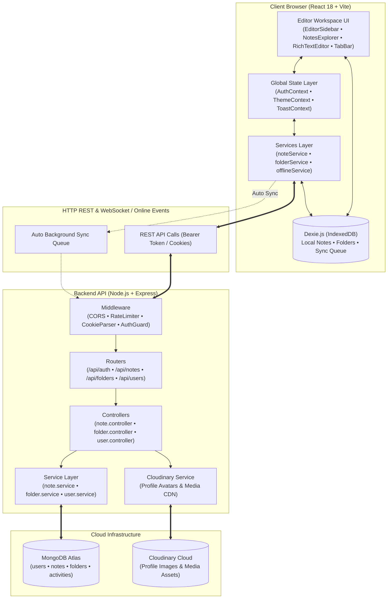
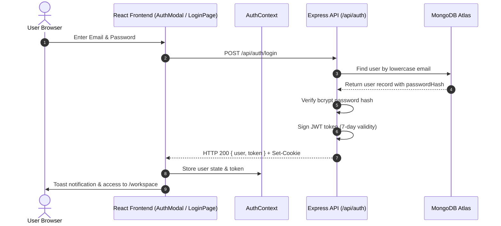
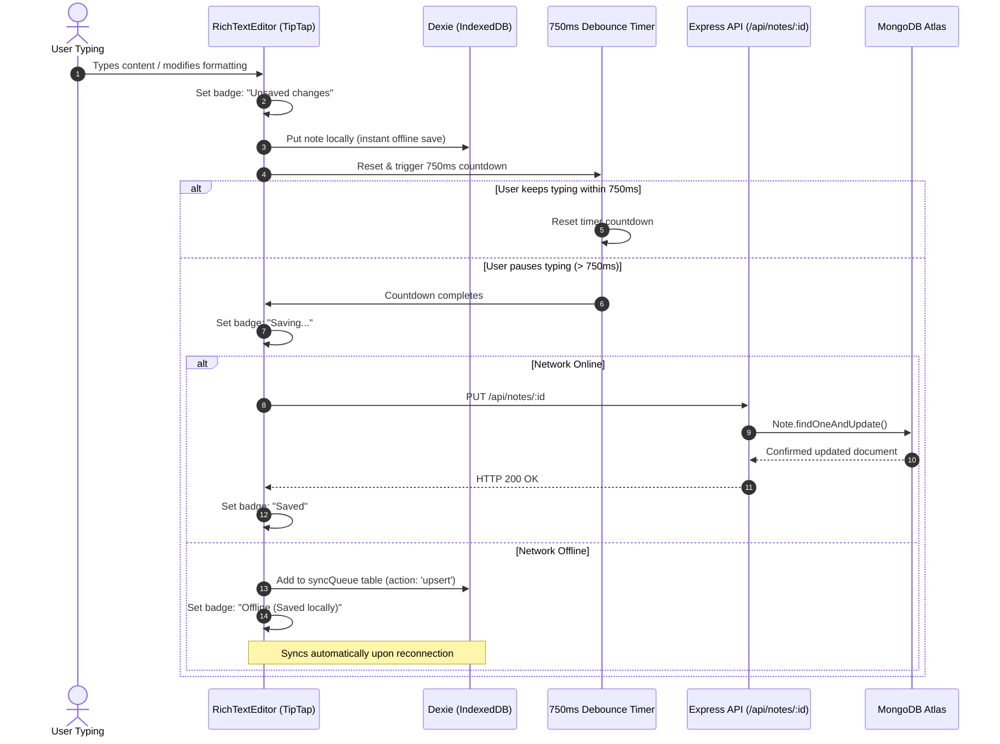
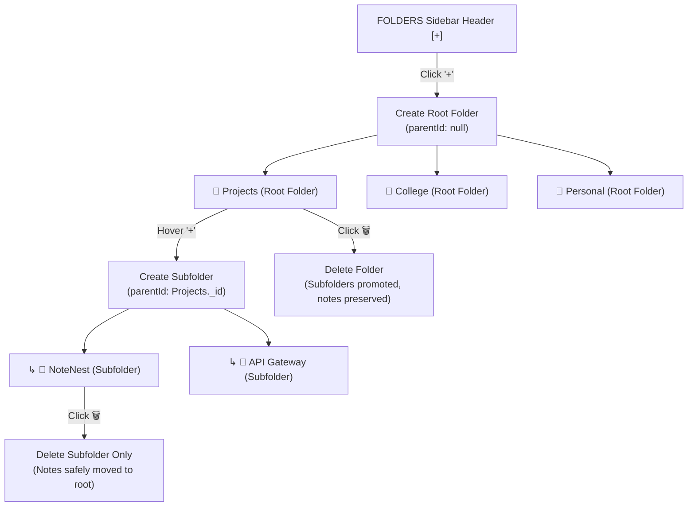
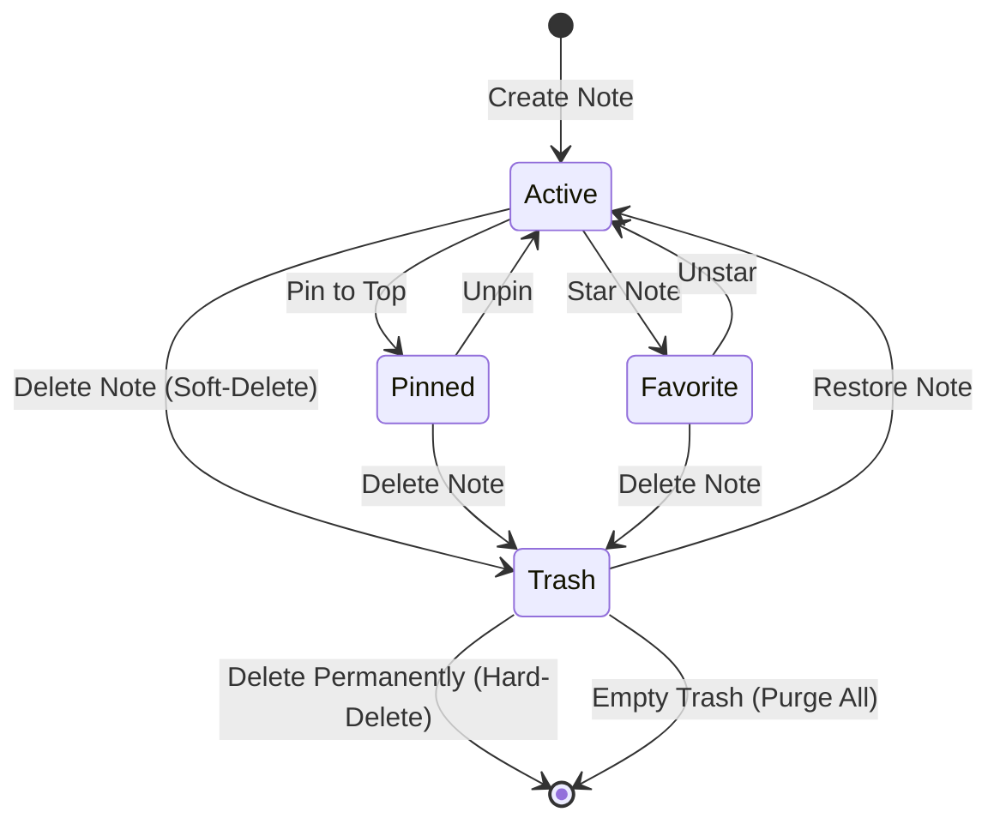

# NoteNest — Modern Editorial Knowledge Workspace

> **Think • Write • Organize • Sync**  
> A full-stack, offline-first editorial workspace built with the **MERN** stack (MongoDB, Express, React, Node.js), powered by **TipTap v2** for rich text, **Dexie.js (IndexedDB)** for offline-first synchronization, and styled in a sleek **Midnight Obsidian & Electric Indigo** design system.

---

## 📑 Table of Contents
1. [Overview & Feature Highlights](#-overview--feature-highlights)
2. [Interactive Feature Matrix](#-interactive-feature-matrix)
3. [Tech Stack Breakdown](#-tech-stack-breakdown)
4. [System Architecture](#-system-architecture)
5. [Core Workflows & Sequence Diagrams](#-core-workflows--sequence-diagrams)
   - [1. Authentication & Session Flow](#1-authentication--session-flow)
   - [2. Debounced Autosave & Offline Sync Engine](#2-debounced-autosave--offline-sync-engine)
   - [3. Recursive Folder & Subfolder Tree](#3-recursive-folder--subfolder-tree)
   - [4. Safe Trash & Recovery Lifecycle](#4-safe-trash--recovery-lifecycle)
6. [Codebase Directory Map](#-codebase-directory-map)
7. [Database Models & Schema Design](#-database-models--schema-design)
8. [Comprehensive API Reference](#-comprehensive-api-reference)
9. [Installation & Local Setup](#-installation--local-setup)
10. [Environment Variables](#-environment-variables)
11. [Database Seeding & Reset](#-database-seeding--reset)
12. [Automated Testing Suite](#-automated-testing-suite)
13. [Team & License](#-team--license)

---

## 🎯 Overview & Feature Highlights

NoteNest brings the speed, fluidity, and aesthetics of modern developer workspaces (inspired by Linear, Raycast, and Obsidian) into a full-featured web app:

- **⚡ Offline-First Architecture**: Built on **Dexie.js (IndexedDB)**. Create, edit, and organize notes completely offline. As soon as you reconnect, your local pending queue automatically synchronizes with MongoDB Atlas.
- **✍️ TipTap v2 Rich Text Suite**: Headless ProseMirror-based WYSIWYG canvas supporting headings (H1–H3), bold, italic, underline, strikethrough, inline code, code blocks, blockquotes, interactive tables, task checklists, bullet/numbered lists, links, and image uploads.
- **🗂️ Recursive Hierarchical Folders**: Multi-level folder and subfolder hierarchy with expand/collapse states, hover `+` inline subfolder creation, and safe per-folder or per-subfolder `🗑` deletion (contained notes automatically move to root).
- **📌 Live Note Lifecycle**: Real-time pin-to-top sorting, golden star favorites filter, custom category tags (`#projects`, `#system-design`, `#dbms`), and instant search with keyword matching.
- **☁️ Cloudinary Media Integration**: Cloud-based storage for user avatars and embedded document assets with automatic smart cropping and CDN delivery.
- **📑 Multi-Tab Workspace**: Open multiple notes side-by-side in top tabs, switch between active drafts effortlessly, and view live document analytics (word count, character count, reading time).
- **🛡️ Rock-Solid Security**: JWT authentication delivered via HTTP-only cookies and bearer tokens, bcrypt password hashing, and endpoint rate limiting.
- **🎨 Obsidian Dark & Light Themes**: Deep Obsidian palette (`#13131b`, `#0d0d14`) paired with vibrant Electric Indigo and purple accents (`#9333ea`, `#a855f7`).

---

## 📊 Interactive Feature Matrix

| Category | Capability | Status | Description |
| :--- | :--- | :---: | :--- |
| **Editor Canvas** | Headings (H1, H2, H3, P) | ✅ | Block formatting dropdown with live selection feedback |
| | Rich Text Formatting | ✅ | Bold, Italic, Underline, Strikethrough, Code |
| | Tables & Grids | ✅ | 3x3 table insertion with column/row controls |
| | Interactive Checklists | ✅ | Checkable task list items with strike-through completion |
| | Media & Images | ✅ | File upload, image URL insertion, paste, and drag & drop |
| | Hyperlinks | ✅ | Interactive URL modal with link edit & remove |
| | Undo / Redo | ✅ | Full history stack management |
| **Workspace UI** | Multi-Tab Interface | ✅ | Open, switch, and close active note tabs |
| | Live Status Indicators | ✅ | 4-state badges: `Saved` (green), `Saving...` (amber), `Unsaved`, `Offline` (blue) |
| | Document Inspector | ✅ | Word count, character count, and estimated reading time |
| | Workspace Sidebar | ✅ | Collapsible left drawer, quick views, and user avatar initials |
| **Folders & Tree** | Top-Level Folders | ✅ | Inline root folder creation directly from sidebar header |
| | Subfolders | ✅ | Create nested subfolders on hover with inline name input |
| | Expand / Collapse | ✅ | Chevron toggles for viewing deep folder branches |
| | Safe Deletion | ✅ | Delete specific subfolder with confirmation; notes safely move to root |
| | Dynamic Counts | ✅ | Real-time note counts computed per folder and subfolder |
| **Organization** | Pinned Notes | ✅ | Priority floating of pinned notes to the top of list views |
| | Favorites Filter | ✅ | Dedicated star-filtered view for critical notes |
| | Multi-Tag Taxonomy | ✅ | Quick tag filtering (`#projects`, `#ui-ux`, `#go`, etc.) |
| | Instant Search | ✅ | Instant client-side & server-side regex title and content search |
| **Trash & Recovery**| Two-Stage Deletion | ✅ | Soft-delete to Trash bin; active notes protected |
| | Restore Notes | ✅ | Single-click note restoration to original folder |
| | Permanent Deletion | ✅ | Irreversible document removal from local & cloud database |
| | Empty Trash | ✅ | One-click purge of all soft-deleted items |
| **Cloud & Offline**| Offline-First Storage | ✅ | Full Dexie (IndexedDB) caching and transaction queue |
| | Background Sync | ✅ | Automatic synchronization upon `online` network event |
| | Cloudinary CDN | ✅ | User avatar upload, smart cropping, and cloud CDN hosting |

---

## 🛠 Tech Stack Breakdown

### Frontend Architecture
- **React 18** — Component-driven declarative UI with hooks and state isolation.
- **Vite 6** — Ultra-fast ES build pipeline and Hot Module Replacement (HMR).
- **TipTap v2 (`@tiptap/react`, `@tiptap/pm`)** — ProseMirror-based modular rich text engine storing clean JSON AST documents.
- **Dexie.js** — High-performance IndexedDB wrapper powering offline-first operations.
- **Tailwind CSS** — Utility-first styling with Midnight Obsidian and Electric Indigo tokens.
- **React Router v7** — Declarative SPA navigation and protected workspace routing.
- **Axios** — HTTP client configured with request/response interceptors for JWT management.
- **Lucide React** — Featherweight vector iconography.

### Backend Architecture
- **Node.js & Express.js** — Event-driven RESTful API server.
- **MongoDB Atlas & Mongoose** — Flexible document store for notes, folders, and user accounts.
- **Cloudinary SDK** — Media upload, transformation, and asset delivery pipeline.
- **JSON Web Tokens (JWT)** — Stateless user sessions via cookies and bearer headers.
- **bcryptjs** — Strong cryptographic password hashing with 10 salt rounds.
- **express-rate-limit** — Rate limiting middleware preventing credential brute-forcing.
- **Jest & Supertest** — Automated testing suite verifying auth, CRUD, and edge cases.

---

## 🏗 System Architecture



---

## 🔄 Core Workflows & Sequence Diagrams

### 1. Authentication & Session Flow



---

### 2. Debounced Autosave & Offline Sync Engine



---

### 3. Recursive Folder & Subfolder Tree



---

### 4. Safe Trash & Recovery Lifecycle



---

## 📂 Codebase Directory Map

```text
NotesMaking/
├── BackEnd/
│   ├── src/
│   │   ├── config/
│   │   │   ├── cloudinary.js       # Cloudinary SDK init & auto-upload helper
│   │   │   ├── db.js               # MongoDB Mongoose connection
│   │   │   └── seed.js             # Demo database seeding logic
│   │   ├── controllers/
│   │   │   ├── auth.controller.js   # User register, login, session handlers
│   │   │   ├── folder.controller.js # Folder CRUD, subfolders, move handlers
│   │   │   ├── note.controller.js   # Note CRUD, duplicate, search, trash
│   │   │   └── user.controller.js   # Profile update & avatar upload handlers
│   │   ├── middleware/
│   │   │   ├── authenticate.js     # JWT extraction & user auth verification
│   │   │   ├── errorHandler.js     # Global HTTP error handling
│   │   │   ├── noteValidator.js    # Payload validation rules
│   │   │   ├── rateLimiter.js      # Brute-force endpoint protection
│   │   │   └── uploadMiddleware.js # Multer file upload handler
│   │   ├── models/
│   │   │   ├── Activity.js         # User action audit logger
│   │   │   ├── Folder.js           # Recursive folder schema with parentId
│   │   │   ├── Note.js             # Note schema (TipTap JSON, tags, flags)
│   │   │   └── User.js             # User account schema with passwordHash
│   │   ├── routes/
│   │   │   ├── auth.routes.js      # /api/auth endpoints
│   │   │   ├── folder.routes.js    # /api/folders endpoints
│   │   │   ├── health.routes.js    # /api/health uptime check
│   │   │   ├── note.routes.js      # /api/notes endpoints
│   │   │   └── user.routes.js      # /api/users profile & avatar endpoints
│   │   ├── services/
│   │   │   ├── auth.service.js     # Authentication business logic
│   │   │   ├── folder.service.js   # Folder hierarchy & subfolder operations
│   │   │   └── note.service.js     # Note persistence & query builder
│   │   │   └── user.service.js     # User profile management
│   │   └── server.js               # Express application initialization
│   ├── .env.example                # Backend environment template
│   ├── package.json                # Backend scripts & dependencies
│   └── tests/                      # Jest & Supertest integration suite
│
├── FrontEnd/
│   ├── src/
│   │   ├── components/
│   │   │   ├── editor/
│   │   │   │   ├── DocumentInspector.jsx # Document analytics & reading metrics
│   │   │   │   ├── EditorLayout.jsx      # Primary 3-panel workspace container
│   │   │   │   ├── EditorSidebar.jsx     # Navigation & recursive folder tree
│   │   │   │   ├── EditorStatusBar.jsx   # Bottom metadata & online status bar
│   │   │   │   ├── EditorTabBar.jsx      # Multi-note tab bar
│   │   │   │   ├── EditorToolbar.jsx     # Full TipTap rich text formatting tools
│   │   │   │   ├── NoteListItem.jsx      # Note preview card with pin/fav badges
│   │   │   │   ├── NotesExplorer.jsx     # Searchable middle list panel
│   │   │   │   └── RichTextEditor.jsx    # Core TipTap WYSIWYG editor canvas
│   │   │   ├── landing/
│   │   │   │   ├── AboutSection.jsx      # Landing feature highlights
│   │   │   │   ├── HeroSection.jsx       # Interactive hero with CTAs
│   │   │   │   ├── LandingFooter.jsx     # Application footer
│   │   │   │   └── PencilNavbar.jsx      # Responsive navigation header
│   │   │   └── modals/
│   │   │       ├── AuthModal.jsx         # Login & Register modal dialog
│   │   │       ├── ConfirmDialog.jsx     # Safe deletion confirmation modal
│   │   │       └── SettingsModal.jsx     # Account & avatar upload modal
│   │   ├── context/
│   │   │   ├── AuthContext.jsx           # Global user authentication state
│   │   │   ├── ThemeContext.jsx          # Dark / Light theme provider
│   │   │   └── ToastContext.jsx          # Interactive toast notification banners
│   │   ├── services/
│   │   │   ├── api.js                    # Axios client with JWT interceptors
│   │   │   ├── authService.js            # Auth API call wrappers
│   │   │   ├── db.js                     # Dexie.js IndexedDB offline engine
│   │   │   ├── folderService.js          # Folder & subfolder API client
│   │   │   └── noteService.js            # Note CRUD & sync client
│   │   ├── App.jsx                       # Routing & context tree
│   │   └── main.jsx                      # React entry point
│   ├── tailwind.config.js                # Midnight Obsidian theme tokens
│   ├── vite.config.js                    # Vite configuration
│   └── package.json                      # Frontend dependencies
│
└── README.md                             # Complete project documentation
```

---

## 🗄 Database Models & Schema Design

### 1. User Model (`BackEnd/src/models/User.js`)
```javascript
{
  name: { type: String, required: true, trim: true },
  email: { type: String, required: true, unique: true, lowercase: true },
  passwordHash: { type: String, required: true },
  avatar: { type: String, default: '' },       // Cloudinary CDN URL or local path
  cloudinaryId: { type: String, default: '' }, // Cloudinary asset public ID
  createdAt: ISODate,
  updatedAt: ISODate
}
```

### 2. Folder Model (`BackEnd/src/models/Folder.js`)
```javascript
{
  userId: { type: ObjectId, ref: 'User', required: true, index: true },
  name: { type: String, required: true, trim: true },
  parentId: { type: ObjectId, ref: 'Folder', default: null }, // Null = root folder
  color: { type: String, default: 'purple' },
  icon: { type: String, default: 'folder' },
  isPinned: { type: Boolean, default: false },
  createdAt: ISODate,
  updatedAt: ISODate
}
```

### 3. Note Model (`BackEnd/src/models/Note.js`)
```javascript
{
  userId: { type: ObjectId, ref: 'User', required: true, index: true },
  folderId: { type: ObjectId, ref: 'Folder', default: null },
  folder: { type: String, default: '' },
  title: { type: String, default: 'Untitled Note', trim: true },
  content: { type: mongoose.Schema.Types.Mixed, default: '' }, // TipTap JSON AST
  plainText: { type: String, default: '', trim: true },       // Extracted for full-text search
  tags: [{ type: String }],
  isPinned: { type: Boolean, default: false },
  isFavorite: { type: Boolean, default: false },
  isDeleted: { type: Boolean, default: false },               // Soft-delete flag
  createdAt: ISODate,
  updatedAt: ISODate
}
```

---

## 🔌 Comprehensive API Reference

All protected routes require an HTTP-only cookie (`token`) or an `Authorization: Bearer <JWT>` header.

### Authentication Endpoints
| Method | Endpoint | Access | Description |
| :--- | :--- | :--- | :--- |
| `POST` | `/api/auth/register` | Public | Register new user account & seed starter workspace |
| `POST` | `/api/auth/login` | Public | Authenticate user & issue signed JWT |
| `POST` | `/api/auth/logout` | Public | Clear authentication cookie |
| `GET` | `/api/auth/me` | Protected | Fetch authenticated user profile |

### Notes Endpoints
| Method | Endpoint | Access | Description |
| :--- | :--- | :--- | :--- |
| `GET` | `/api/notes` | Protected | List all active notes (supports `?search=`, `?filter=`, `?folder=`) |
| `GET` | `/api/notes/stats` | Protected | Fetch note metrics (`all`, `favorites`, `trash`) |
| `GET` | `/api/notes/:id` | Protected | Fetch a single note document |
| `POST` | `/api/notes` | Protected | Create a new note document |
| `PUT` | `/api/notes/:id` | Protected | Update note title, content, or metadata (autosave) |
| `PATCH` | `/api/notes/:id/pin` | Protected | Toggle pin-to-top status |
| `PATCH` | `/api/notes/:id/favorite` | Protected | Toggle favorite status |
| `PATCH` | `/api/notes/:id/trash` | Protected | Soft-delete note to trash (or restore) |
| `DELETE` | `/api/notes/:id` | Protected | Permanently erase note from database |
| `DELETE` | `/api/notes/trash/empty` | Protected | Empty all soft-deleted trash notes |

### Folders & Subfolders Endpoints
| Method | Endpoint | Access | Description |
| :--- | :--- | :--- | :--- |
| `GET` | `/api/folders` | Protected | List all user folders & subfolder relationships |
| `POST` | `/api/folders` | Protected | Create root folder or subfolder (`{ name, parentId }`) |
| `GET` | `/api/folders/:id` | Protected | Fetch single folder by ID |
| `PATCH` | `/api/folders/:id` | Protected | Rename folder or update color/icon |
| `PATCH` | `/api/folders/:id/move` | Protected | Move folder under another parent (`{ parentId }`) |
| `DELETE` | `/api/folders/:id` | Protected | Delete folder safely; contained notes move to root |

### User Profile & Cloudinary Media Endpoints
| Method | Endpoint | Access | Description |
| :--- | :--- | :--- | :--- |
| `PATCH` | `/api/users/profile` | Protected | Update name, username, or bio |
| `POST` | `/api/users/profile/avatar` | Protected | Upload user avatar to Cloudinary CDN (multipart/form-data) |
| `PUT` | `/api/users/password` | Protected | Update account password |

---

## ⚡️ Installation & Local Setup

### Prerequisites
- **Node.js** v18+ (tested on Node v20 & v22)
- **MongoDB** (Cloud cluster via [MongoDB Atlas](https://www.mongodb.com/cloud/atlas) or local instance)
- *(Optional)* **Cloudinary Account** for user avatar cloud hosting

### 1. Clone & Install Dependencies
```bash
git clone https://github.com/AnshumanGarg5410/NotesMaking.git
cd NotesMaking
npm run install:all
```

### 2. Configure Environment Variables
- Set up `BackEnd/.env` (see below)
- Set up `FrontEnd/.env` (see below)

### 3. Run Development Servers
```bash
# Concurrently starts Backend on :5001 and Frontend on :5173
npm run dev
```

- **Frontend Application**: [http://localhost:5173](http://localhost:5173)
- **Backend API Server**: [http://localhost:5001](http://localhost:5001)
- **API Health Check**: [http://localhost:5001/api/health](http://localhost:5001/api/health)

---

## 🔐 Environment Variables

### Backend (`BackEnd/.env`)
```env
PORT=5001
NODE_ENV=development

# MongoDB Connection String
MONGO_URI=mongodb+srv://<username>:<password>@cluster.mongodb.net/notesMaking?retryWrites=true&w=majority

# JWT Authentication
JWT_SECRET=your_super_secret_jwt_key_at_least_32_chars_long
JWT_EXPIRY=7d
CLIENT_URL=http://localhost:5173

# Cloudinary Integration (User Avatar & Media CDN)
CLOUDINARY_CLOUD_NAME=your_cloudinary_cloud_name
CLOUDINARY_API_KEY=your_cloudinary_api_key
CLOUDINARY_API_SECRET=your_cloudinary_api_secret
```

### Frontend (`FrontEnd/.env`)
```env
VITE_API_URL=http://localhost:5001/api
```

---

## 🧪 Database Seeding & Reset

To reset your test database with demo users and pre-formatted starter notes:

```bash
cd BackEnd
npm run seed
```

### Pre-Configured Demo Account
| Credential | Value |
| :--- | :--- |
| **Email** | `demo@notely.com` |
| **Password** | `password123` |
| **Sample Workspace** | 7 pre-populated notes with tags, checklists, code blocks, and folders |

---

## 🚦 Automated Testing Suite

The backend includes a comprehensive automated test suite powered by **Jest** and **Supertest**:

```bash
cd BackEnd
npm test
```

Expected output:
```text
PASS tests/notes.test.js
PASS tests/auth.test.js

Test Suites: 2 passed, 2 total
Tests:       15 passed, 15 total
Snapshots:   0 total
Time:        ~10s
```

---

## 👥 Team & License

Released under the **MIT License**. Free for personal and commercial development.
