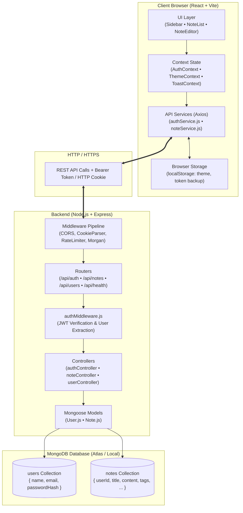
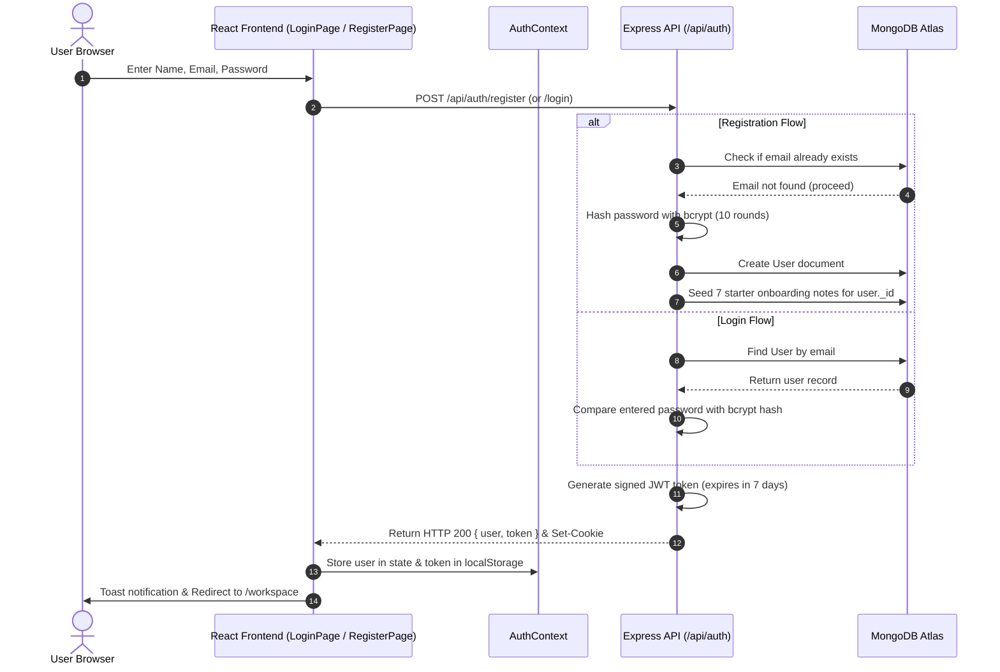
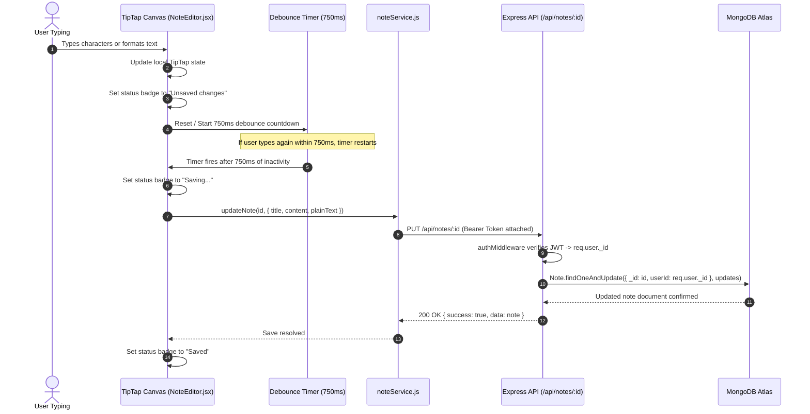
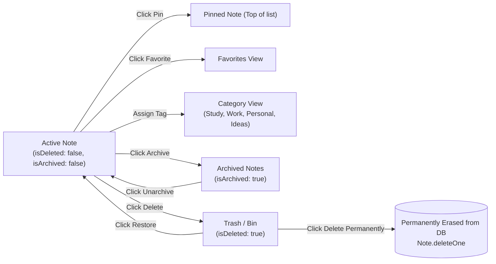
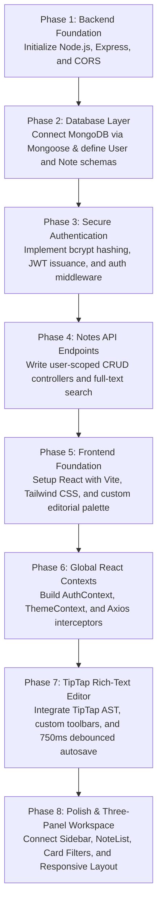

# Notely — Complete Architecture & Developer Guide

> **Write • Organize • Think**  
> A full-stack, editorial note-taking and knowledge base application built with the **MERN** stack (MongoDB, Express, React, Node.js), styled with Tailwind CSS, and powered by TipTap for rich-text editing.

---

## 📑 Table of Contents
1. [Overview & Demo Credentials](#-overview--demo-credentials)
2. [Tech Stack Breakdown & Why Each Was Chosen](#-tech-stack-breakdown)
3. [End-to-End System Architecture](#-end-to-end-system-architecture)
4. [How Everything Works (Flowcharts)](#-how-everything-works-flowcharts)
   - [Authentication & Registration Flow](#1-authentication--registration-flow)
   - [Note Creation & Debounced Autosave Flow](#2-note-creation--debounced-autosave-flow)
   - [Filtering, Searching & Soft-Delete (Trash) Flow](#3-filtering-searching--soft-delete-trash-flow)
5. [What Is Done Where (Directory Map)](#-what-is-done-where-directory-map)
6. [Database Models & Schema Design](#-database-models--schema-design)
7. [API Reference & Payload Validation](#-api-reference)
8. [Beginner's Guide: How to Build This from Scratch](#-beginners-guide-how-to-build-this-from-scratch)
9. [Installation & Setup](#-installation--setup)
10. [Database Seeding & Reset](#-database-seeding--reset)
11. [Automated Testing Suite](#-automated-testing-suite)
12. [Authors & License](#-authors--license)

---

## 🎯 Overview & Demo Credentials

Notely combines the sleek aesthetic of modern developer workspaces (**Electric Indigo & Midnight Obsidian**, inspired by Linear and Raycast) with rock-solid full-stack web engineering:
- **Instant Debounced Autosave**: Automatic background saving as you type (750ms debounce) with real-time status indicators (*Saved*, *Saving...*, *Unsaved changes*).
- **Rich-Text Canvas**: Headings (H1–H3), bold, italic, underline, strike, blockquotes, bullet lists, ordered lists, task checkboxes, code blocks, tables, and links powered by TipTap.
- **Organization & Filtering**: Pinned notes, favorites, categories/tags (`Study`, `Work`, `Personal`, `Ideas`), color-coded cards, and an archive/trash lifecycle.
- **One-Click Note Duplication**: Rapid cloning of any note with title suffixes and preserved tags/canvas styling.
- **Export to Markdown & Plain Text**: Download notes as `.md` or `.txt` directly from the editor.
- **Live Document Metrics**: Live stats bar calculating word count, character count, and estimated reading time.
- **Bulk Trash Cleanup**: Single-click Empty Trash endpoint with client-side confirmation dialog.
- **Payload Validation**: Strict validation middleware on note creation and updates (title length, allowed colors, and tag counts).
- **Strict User Privacy**: Every note query enforces user ownership at the database layer; User A can never inspect or mutate User B's notes.
- **Fault Tolerance**: Wrapped in a top-level React `ErrorBoundary` for smooth error recovery without crashes.

### Ready-to-use Demo Account
| Credential | Value |
| :--- | :--- |
| **Email** | `demo@notely.com` |
| **Password** | `password123` |
| **Sample Notes** | 7 pre-populated notes with tags, colors, checklists, and rich formatting |

---

## 🛠 Tech Stack Breakdown

### Frontend
| Technology | Role | Why It Was Chosen |
| :--- | :--- | :--- |
| **React 18** | UI Framework | Component-based view architecture, hooks, and clean state synchronization. |
| **Vite** | Bundler & Dev Server | Lightning-fast Hot Module Replacement (HMR) and optimized ES build outputs. |
| **Tailwind CSS** | Styling System | Utility-first CSS allowing custom design tokens (`cream`, `charcoal`, `terracotta`) and effortless dark mode support. |
| **TipTap v2** | Rich-Text Engine | Headless, ProseMirror-based rich-text editor that stores clean JSON AST documents instead of messy raw HTML strings. |
| **React Router v7** | Routing | Client-side routing with `ProtectedRoute` guards for authenticated workspace access. |
| **Axios** | HTTP Client | Request/response interceptors to automatically attach JWT headers and handle 401 session expirations. |
| **Lucide React** | Icons | Consistent, featherweight iconography. |
| **Context API** | State Management | Native React state management for `AuthContext`, `ThemeContext`, and `ToastContext` without excessive external libraries. |
| **Error Boundary** | Fault Tolerance | Component-level error handling catching rendering errors with graceful reload options. |

### Backend
| Technology | Role | Why It Was Chosen |
| :--- | :--- | :--- |
| **Node.js** | Runtime Environment | High-performance asynchronous, event-driven JavaScript engine. |
| **Express.js** | Web Framework | Minimalist routing, middleware chaining, and robust JSON API architecture. |
| **MongoDB & Mongoose** | Database & ODM | Flexible document-oriented JSON schema ideal for storing rich-text trees (`Mixed`), arrays of tags, and nested content. |
| **JSON Web Tokens (JWT)** | Authentication | Stateless authentication signed with a secret key; delivered via HTTP-only cookies and Authorization headers. |
| **bcryptjs** | Password Hashing | Secure one-way hashing with 10 salt rounds to protect user passwords against rainbow-table attacks. |
| **express-rate-limit** | Security | Protects authentication endpoints against automated brute-force attacks. |
| **cookie-parser** | Middleware | Parses HTTP cookies for seamless cookie-based JWT sessions. |
| **Jest & Supertest** | Automated Testing | Comprehensive unit and API integration testing suite validating auth, notes, validation, and error edge cases. |

---

## 🏗 End-to-End System Architecture



---

## 🔄 How Everything Works (Flowcharts)

### 1. Authentication & Registration Flow

How a user creates an account or logs in, receives a secure token, and gets redirected to the workspace:



---

### 2. Note Creation & Debounced Autosave Flow

How typing in the rich-text editor automatically and safely saves to the cloud without hammering the server:



---

### 3. Filtering, Searching & Soft-Delete (Trash) Flow

How notes are organized, archived, searched, and recovered:



---

## 📂 What Is Done Where (Directory Map)

Here is where every feature lives across the codebase:

```text
NotesMaking/
├── BackEnd/
│   ├── config/
│   │   └── db.js                 # Database connection logic (reads MONGO_URI)
│   ├── controllers/
│   │   ├── authController.js     # Register, Login, Logout, getMe handlers
│   │   ├── noteController.js     # CRUD, search, tags, pin, archive, trash, duplicate operations
│   │   └── userController.js     # User profile updates and preferences
│   ├── middleware/
│   │   ├── auth.js               # Verifies JWT token and attaches req.user
│   │   ├── errorHandler.js       # Centralized JSON error response handler
│   │   ├── noteValidator.js      # Validates note title length, allowed colors, and tag limits
│   │   └── rateLimiter.js        # Prevents brute-force requests on auth endpoints
│   ├── models/
│   │   ├── Note.js               # Note schema (title, TipTap content, tags, flags)
│   │   └── User.js               # User schema (name, email, passwordHash)
│   ├── routes/
│   │   ├── authRoutes.js         # /api/auth routes
│   │   ├── healthRoutes.js       # /api/health endpoint for uptime monitoring
│   │   ├── noteRoutes.js         # /api/notes routes (all protected by auth)
│   │   └── userRoutes.js         # /api/users routes
│   ├── scripts/
│   │   └── resetAndSeed.js       # Wipes database and seeds demo user & notes
│   ├── tests/
│   │   ├── auth.test.js          # Integration tests for registration, login, profile
│   │   └── notes.test.js         # Integration tests for CRUD, duplicate, empty trash, validation
│   ├── utils/
│   │   ├── generateToken.js      # Creates signed JWT and sets HTTP-only cookies
│   │   └── seedNotes.js          # Onboarding notes template builder
│   ├── .env                      # Secret configuration (MONGO_URI, JWT_SECRET, PORT)
│   ├── .env.example              # Template configuration for developers
│   ├── package.json              # Backend dependencies & npm scripts (start, dev, seed, test)
│   └── server.js                 # Express app initialization, middleware, and route mounting
│
├── FrontEnd/
│   ├── src/
│   │   ├── components/
│   │   │   ├── common/
│   │   │   │   ├── ErrorBoundary.jsx         # Global error fallback component catching runtime errors
│   │   │   │   ├── Header.jsx                # Top bar with search, dark mode toggle, profile
│   │   │   │   └── LandscapeIllustration.jsx # Cosmic Obsidian Nebula vector illustration in sidebar
│   │   │   ├── editor/
│   │   │   │   ├── EditorToolbar.jsx         # Buttons for Bold, Italic, H1-H3, Lists, Tables
│   │   │   │   └── NoteEditor.jsx            # TipTap editor with autosave, export, and live stats bar
│   │   │   ├── modals/
│   │   │   │   ├── ConfirmDialog.jsx         # Modal for permanent deletion confirmation
│   │   │   │   ├── FilterModal.jsx           # Tag, category, and color filter picker
│   │   │   │   └── SettingsModal.jsx         # User account preferences
│   │   │   ├── notes/
│   │   │   │   ├── NoteCard.jsx              # Individual note card in list with color, tags, options
│   │   │   │   └── NoteList.jsx              # Searchable, grouped list of notes with empty trash bar
│   │   │   └── sidebar/
│   │   │       └── Sidebar.jsx               # Navigation folders (All, Favorites, Tags, Trash)
│   │   ├── context/
│   │   │   ├── AuthContext.jsx               # Global user authentication state
│   │   │   ├── ThemeContext.jsx              # Light / Dark mode state & localStorage sync
│   │   │   └── ToastContext.jsx              # Toast banner notifications (success, error)
│   │   ├── pages/
│   │   │   ├── LoginPage.jsx                 # User sign-in page
│   │   │   ├── RegisterPage.jsx              # User registration page
│   │   │   └── WorkspacePage.jsx             # Main 3-panel note-taking desktop interface
│   │   ├── routes/
│   │   │   └── ProtectedRoute.jsx            # Route wrapper preventing unauthenticated access
│   │   ├── services/
│   │   │   ├── api.js                        # Axios base instance with token interceptors
│   │   │   ├── authService.js                # API call wrappers for register, login, logout
│   │   │   └── noteService.js                # API call wrappers for all note operations
│   │   ├── App.jsx                           # Application routing, ErrorBoundary, & context providers
│   │   ├── index.css                         # Tailwind CSS directives & Electric Indigo design tokens
│   │   └── main.jsx                          # React DOM mount point
│   ├── .env.example                          # Template for frontend environment
│   ├── index.html                            # HTML entry point with Google Fonts
│   ├── tailwind.config.js                    # Electric Indigo & Midnight Obsidian tokens & palette
│   └── vite.config.js                        # Vite bundler configuration
│
├── .gitignore                                # Excludes node_modules, .env, and build artifacts
├── package.json                              # Root package.json to run frontend & backend together
└── README.md                                 # Complete documentation
```

---

## 🗄 Database Models & Schema Design

### 1. User Model (`BackEnd/models/User.js`)
```javascript
{
  name: { type: String, required: true, trim: true },
  email: { type: String, required: true, unique: true, lowercase: true },
  passwordHash: { type: String, required: true },
  avatarUrl: { type: String, default: '' },
  createdAt: ISODate,
  updatedAt: ISODate
}
```
- **Security**: The `toJSON` transform automatically strips `passwordHash` and `__v` before sending responses to the client.
- **Methods**: `matchPassword(enteredPassword)` compares passwords using `bcrypt.compare`.

### 2. Note Model (`BackEnd/models/Note.js`)
```javascript
{
  userId: { type: ObjectId, ref: 'User', required: true, index: true },
  title: { type: String, default: 'Untitled Note', trim: true },
  content: { type: mongoose.Schema.Types.Mixed, default: '' },   // TipTap JSON AST
  plainText: { type: String, default: '', trim: true },         // Extracted for search
  tags: [{ type: String }],                                     // e.g. ['Study', 'Work']
  color: { 
    type: String, 
    default: 'default',
    enum: ['default', 'cream', 'amber', 'rose', 'emerald', 'sky', 'purple'] 
  },
  icon: { type: String, default: 'document' },
  isPinned: { type: Boolean, default: false },
  isFavorite: { type: Boolean, default: false },
  isArchived: { type: Boolean, default: false },
  isDeleted: { type: Boolean, default: false },                 // Soft-delete (Trash)
  createdAt: ISODate,
  updatedAt: ISODate
}
```
- **Performance Indexes**:
  - `{ userId: 1, isDeleted: 1, isArchived: 1, isPinned: -1, updatedAt: -1 }` (Rapid filtering of active notes)
  - `{ title: 'text', plainText: 'text', tags: 'text' }` (Full-text search)

---

## 🔌 API Reference

All protected endpoints require either an **HTTP-only cookie** (`token`) or an **`Authorization: Bearer <JWT>`** header.

### Authentication Endpoints
| Method | Endpoint | Access | Description |
| :--- | :--- | :--- | :--- |
| `POST` | `/api/auth/register` | Public | Create new account & seed starter notes |
| `POST` | `/api/auth/login` | Public | Authenticate user & issue JWT token |
| `POST` | `/api/auth/logout` | Public | Clears authentication cookie |
| `GET` | `/api/auth/me` | Protected | Returns current authenticated user profile |

### Notes Endpoints
| Method | Endpoint | Access | Description |
| :--- | :--- | :--- | :--- |
| `GET` | `/api/notes` | Protected | Get all active notes (supports `?search=`, `?tag=`, `?folder=`) |
| `GET` | `/api/notes/:id` | Protected | Fetch a single note by ID (user-isolated) |
| `POST` | `/api/notes` | Protected | Create a new note |
| `POST` | `/api/notes/:id/duplicate` | Protected | Duplicate note with '(Copy)' suffix & preserve tags/color |
| `PUT` | `/api/notes/:id` | Protected | Update note title, content, color, or tags (autosave) |
| `PATCH` | `/api/notes/:id/pin` | Protected | Toggle note pinned status |
| `PATCH` | `/api/notes/:id/favorite` | Protected | Toggle note favorite status |
| `PATCH` | `/api/notes/:id/archive` | Protected | Toggle note archive status |
| `PATCH` | `/api/notes/:id/trash` | Protected | Soft-delete note to trash (or restore) |
| `DELETE` | `/api/notes/:id` | Protected | Permanently erase note from database |
| `DELETE` | `/api/notes/trash/empty` | Protected | Empty all notes currently in trash |

### Note Payload Validation Rules (`noteValidator.js`)
All incoming `POST /api/notes` and `PUT /api/notes/:id` payloads are checked before hitting controller logic:
- **`title`**: String, trimmed, maximum length of 200 characters.
- **`color`**: Optional string, must be one of: `['default', 'cream', 'amber', 'rose', 'emerald', 'sky', 'purple']`.
- **`tags`**: Optional array of strings, maximum 20 tags per note, maximum 30 characters per tag.

### System Endpoints
| Method | Endpoint | Access | Description |
| :--- | :--- | :--- | :--- |
| `GET` | `/api/health` | Public | Healthcheck returns server status & DB connection state |

---

## 🎓 Beginner's Guide: How to Build This from Scratch

If you want to understand how this entire project was built and build it yourself from an empty folder, follow these 8 foundational stages:



### Phase 1: Initialize the Backend Server
1. Create a `BackEnd` directory, run `npm init -y`, and install dependencies:
   ```bash
   npm install express mongoose dotenv cors cookie-parser jsonwebtoken bcryptjs morgan express-rate-limit
   ```
2. Create `server.js` to initialize Express, enable JSON parsing (`express.json()`), CORS, and mount your routes.

### Phase 2: Connect MongoDB & Define Schemas
1. Create `config/db.js` using `mongoose.connect(process.env.MONGO_URI)`.
2. Define `models/User.js` with fields `name`, `email`, and `passwordHash`.
3. Define `models/Note.js` referencing `userId` with fields `title`, `content` (`mongoose.Schema.Types.Mixed`), `tags`, `color`, and status booleans.

### Phase 3: Build the Authentication System
1. In `controllers/authController.js`, implement `register`:
   - Validate email format and check for duplicates.
   - Hash password with `bcrypt.hash(password, 10)`.
   - Create user and issue a JWT signed with `JWT_SECRET`.
2. In `middleware/auth.js`, create a function that reads the token from `req.cookies.token` or `req.headers.authorization`. Verify it with `jwt.verify` and attach `req.user = user`.

### Phase 4: Build RESTful CRUD Endpoints
1. Create `controllers/noteController.js`.
2. **Crucial rule for security**: Always query with `{ _id: req.params.id, userId: req.user._id }`. This prevents users from accessing or modifying another user's notes.
3. Add filtering logic for `isPinned`, `isFavorite`, `isArchived`, `isDeleted`, and full-text regex search.

### Phase 5: Initialize the Frontend with Vite
1. In the root, create the React app:
   ```bash
   npm create vite@latest FrontEnd -- --template react
   ```
2. Install styling & icons:
   ```bash
   npm install tailwindcss postcss autoprefixer lucide-react axios react-router-dom
   ```
3. Install TipTap editor extensions:
   ```bash
   npm install @tiptap/react @tiptap/pm @tiptap/starter-kit @tiptap/extension-placeholder @tiptap/extension-underline @tiptap/extension-link @tiptap/extension-task-list @tiptap/extension-task-item @tiptap/extension-table @tiptap/extension-table-row @tiptap/extension-table-header @tiptap/extension-table-cell
   ```

### Phase 6: Global State & API Services
1. Configure `services/api.js` with Axios. Add a request interceptor that extracts `localStorage.getItem('notely_token')` and attaches `Authorization: Bearer <token>`.
2. Create `context/AuthContext.jsx` to store current user state across the application.
3. Wrap authenticated routes with `ProtectedRoute.jsx` so unauthenticated visitors are redirected to `/login`.

### Phase 7: Build the Rich-Text Editor & Autosave
1. In `components/editor/NoteEditor.jsx`, initialize TipTap using `useEditor()`.
2. When the user modifies text, trigger an `onUpdate` event.
3. Implement debounced saving:
   - Create a timer ref (`useRef()`).
   - Clear existing timeout and set a new 750ms timeout.
   - When the timer completes, call `noteService.updateNote(id, data)` and toggle your status indicator from "Saving..." to "Saved".

### Phase 8: Assemble the 3-Panel Workspace
1. Build `Sidebar.jsx` on the left: Category tabs (*All, Favorites, Study, Work, Archive, Trash*) and note counters.
2. Build `NoteList.jsx` in the middle: Search bar, sorting dropdown, and clickable `NoteCard.jsx` items.
3. Place `NoteEditor.jsx` on the right: Main writing area that renders the active note.

---

## ⚡️ Installation & Setup

### Prerequisites
- **Node.js** v18+ (tested on Node v20 & v22)
- **MongoDB** (local MongoDB instance or free cloud cluster on [MongoDB Atlas](https://www.mongodb.com/cloud/atlas))

### 1. Clone & Install Dependencies
From the repository root:
```bash
npm run install:all
```
*(Or install manually inside both `BackEnd/` and `FrontEnd/` with `npm install`)*

---

### 2. Environment Configuration

#### Backend Configuration (`BackEnd/.env`)
Create a `.env` file in the `BackEnd/` folder:
```env
PORT=5001
NODE_ENV=development

# MongoDB Connection (Atlas Cloud or Local MongoDB)
MONGO_URI=mongodb+srv://<username>:<password>@cluster.mongodb.net/notesMaking?retryWrites=true&w=majority
# Or for local: MONGO_URI=mongodb://127.0.0.1:27017/notely_db

JWT_SECRET=your_super_secret_jwt_key_here_at_least_32_characters
JWT_EXPIRY=7d
CLIENT_URL=http://localhost:5173
```

#### Frontend Configuration (`FrontEnd/.env`)
Create a `.env` file in the `FrontEnd/` folder:
```env
VITE_API_URL=http://localhost:5001/api
```

---

### 3. Running the App Locally

#### Run Both Frontend and Backend Concurrently (Recommended):
From the root project folder:
```bash
npm run dev
```
- **Frontend App**: `http://localhost:5173`
- **Backend API**: `http://localhost:5001`

#### Or Run Independently in Separate Terminals:
- **Terminal 1 (Backend)**:
  ```bash
  cd BackEnd
  npm run dev
  ```
- **Terminal 2 (Frontend)**:
  ```bash
  cd FrontEnd
  npm run dev
  ```

---

## 🧪 Database Seeding & Reset

Whenever you want to clear out test accounts and start completely fresh with the demo user and pre-populated sample notes, run:

```bash
cd BackEnd
npm run seed
```

This will:
1. Connect to your active MongoDB database (`notesMaking`).
2. Clear all documents in `users` and `notes`.
3. Create the demo account: `demo@notely.com` / `password123`.
4. Seed 7 diverse, rich-text starter notes with tags, colors, and formatting.

---

## 🚦 Automated Testing Suite

The backend includes a comprehensive automated test suite powered by **Jest** and **Supertest** covering authentication, CRUD operations, duplicate endpoints, soft-delete & empty trash flows, and validation rules.

Run all tests:
```bash
cd BackEnd
npm test
```

Expected output:
```text
PASS tests/notes.test.js
PASS tests/auth.test.js

Test Suites: 2 passed, 2 total
Tests:       15 passed, 15 total
Snapshots:   0 total
Time:        ~10s
```

---

## 👥 Authors & License

**Core Team:**
- **Anshuman Garg** — `anshumangarg5410@gmail.com`
- **Parth Sohal** — `sohalparth72@gmail.com`
- **Samarjeet Singh** — `samarjeetd09@gmail.com`

Released under the **MIT License**. Feel free to use, modify, and build upon this project!
